 
 

<a href="https://github.com/syn990/syn990/tree/main/home/Documents">Documents</a> ·
<a href="https://github.com/syn990/syn990/tree/main/home/Pictures">Pictures</a> ·
<a href="https://github.com/syn990/syn990/tree/main/usr/bin">Tools</a> ·
<a href="https://github.com/syn990/syn990/blob/main/home/whoami.md">whoami</a> ·
<a href="mailto:william@npc.syntax990.com">william@npc.syntax990.com</a> ·
<a href="https://www.linkedin.com/in/william-hayward-holland-990">LinkedIn</a> ·
<a href="https://www.youtube.com/@syn990">YouTube</a>

