<a href="https://github.com/syn990"></a>

[◂ Desktop](https://github.com/syn990) · [~/Documents](./) · SYN-BIOGENESIS.md

# SYN-BIOGENESIS

Biogenesis, the artificial-life simulator, reimplemented in C11 and SDL2.


SYN-BIOGENESIS is a native reimplementation of [Biogenesis](https://biogenesis.sourceforge.net/) 0.9, made as a tool for SYN-OS so the simulator runs without Java. It isn't a remake: given the same seed and parameters, it computes the same world as the original Java program, bit for bit, on every frame, about 2.2 times as fast.

Biogenesis is the work of **Joan Queralt Molina**, who wrote versions 0.1 to 0.8 (2006 to 2010), and **MarcoDBAA**, who released 0.9 in 2019 with **Richard David Williams**'s STRtree collision detection. The simulation, its rules, its parameters and its look are theirs; this project rewrites them in another language and is not affiliated with them.

## A petri dish

A world starts with fifteen random organisms in air that holds carbon dioxide and nothing else, and from then on nobody steers it. Organisms photosynthesise, eat, infect and kill each other, reproduce with small copying errors, and die of age or hunger. What survives is whatever happens to work.

An organism is a body of coloured line segments, and each colour does one thing:

| Colour | What a segment of it does |
|---|---|
| **Green** | Photosynthesis, in proportion to its length and the CO2 left in the air |
| **Red** | Eats what it touches, living or dead |
| **Cyan** | Cilia: now and then a kick along the segment |
| **Blue** | Shield against red, white and gray |
| **White** | Infection: the victim's next child carries the infector's genetic code |
| **Gray** | Kills what it touches |
| **Yellow** | One more child per birth, sharing the same energy |
| **Brown** | Dead; corpses drift and decay back into CO2 |

| | | |
|---|---|---|
|  |  |  |
| An organism selected, at 300% | The genetic laboratory | Statistics |

## The SYN edition

The same simulation has a second interface, drawn in SYN-OS's own themes, with a main menu over the living world, a command palette and a console. A seed gives the same world bit for bit in either.

| | |
|---|---|
|  |  |
| The main menu over the world | An organism's card (SYN-OS-RED) |
|  |  |
| The commands (SYN-OS-HALO-CYAN) | The console (SYN-OS-MATRIX) |

## Build and run

Needs a C compiler, SDL2, SDL2_ttf and SDL2_image (on Arch: `sdl2-compat sdl2_ttf sdl2_image`).

```sh
make
./syn-biogenesis            # what was used last; the first time, Biogenesis 0.9
./syn-biogenesis 42         # Biogenesis 0.9, seeded, like `java -jar biogenesis.jar 42`
./syn-biogenesis --colour   # Color Mod 2.01
```

---

[Repository](https://github.com/syn990/SYN-BIOGENESIS) · [Credits](https://github.com/syn990/SYN-BIOGENESIS#credits) · [SYN-OS.md](SYN-OS.md)
