<a href="https://github.com/syn990"></a>

[◂ Desktop](https://github.com/syn990) · [~/Documents](./) · SYN-OS.md

# SYN-OS

A Linux desktop, built end to end: labwc, Waybar, foot and mako configured as one system, 63 live themes, and a set of native tools written for it. One answers file, `synos.conf`, drives the installer.


Most distros make the choices for you and then hide where those choices live. This one doesn't. Every package is listed plainly, every config is the actual file, and the install runs through scripts you can read start to finish. If something behaves oddly, the file that caused it is somewhere in the project.

## Arch or LFS

The same desktop is built on one of two bases:

| | Arch | LFS |
|---|---|---|
| Base | Arch Linux | Linux From Scratch 13.1, compiled, with SYN-OS's own kernel |
| Init | systemd | runit |
| Packages | pacman | Void Linux's, through xbps, or compiled from source |
| Build | minutes | hours, with 60 GB free |

Both give a bootable ISO with a live session and the same installer: UEFI or BIOS, systemd-boot, rEFInd, GRUB or syslinux, LUKS2, LVM, and ext4, f2fs, btrfs or xfs.


## Build one, install it

On an Arch Linux machine:

```bash
git clone https://github.com/syn990/SYN-OS.git && cd SYN-OS
zsh BUILD.zsh                  # what it can build
zsh BUILD.zsh syn-os-arch      # SYN-OS on Arch
zsh BUILD.zsh syn-os-lfs       # SYN-OS on LFS
```

Then boot the ISO:

```bash
synos-config     # edit /etc/syn-os/synos.conf
synos-install    # asks for anything left at CHANGE_ME, confirms, wipes the disk
```

## From the LFS stream

| | |
|---|---|
|  |  |
| surf on an early LFS image, before GStreamer's audio plugins were built | The installed system's initramfs, before `/usr/sbin` was merged into `/usr/bin` |


## Its tools

SYN-OS ships its own programs for the jobs other desktops hand to a stack of separate utilities: networking, remote machines, the system monitor, the mixer, files, encryption, wallpapers, password prompts, the bar's daemon and the ISO builder. Each has a page in [/usr/bin](../../usr/bin/).

---

[Repository](https://github.com/syn990/SYN-OS) · [The full notes](https://github.com/syn990/SYN-OS/blob/main/docs/README-full.md) · [Why SYN-OS exists](https://github.com/syn990/SYN-OS/blob/main/SYN-ISO-PROFILE/airootfs/usr/share/syn-os/docs/philosophy.md) · [history.md](history.md)
