<a href="https://github.com/syn990"></a>

[◂ Desktop](https://github.com/syn990) · [~/Documents](./) · SYN-RTOS.md

# SYN-RTOS

The Syntax Real-Time Operating System: where SYN-OS started.


By 2021 I'd been hand-building Arch installs, rewriting dotfiles and compiling custom ISOs from memory for years, with nothing saved anywhere. SYN-RTOS was the first time it went into a repository. It wasn't started as "let's build an OS"; it was closer to "this is getting too messy to keep redoing from scratch".

It was an archiso profile and a set of install scripts: build a live ISO with `mkarchiso`, boot it, read `syn-stage0.sh`, and run it. The desktop was a loose set of parts rather than one desktop environment: Openbox for windows, Tint2 for the panel, xcompmgr for compositing, curated dotfiles, and three themes that kept font, colour and layout consistent.

| | |
|---|---|
|  |  |
| The red SYN theme | Openbox's menu |
|  |  |
| The first version | Browsing files with ranger |

In 2023 it became SYN-OS, and the name has stuck since. The repository is kept as it was in February 2023.

```
# mkarchiso -v -w /path/to/work_dir -o /path/to/out_dir /path/to/profile/
```

---

[Repository](https://github.com/syn990/SYN-RTOS) · [SYN-OS.md](SYN-OS.md) · [history.md](history.md)
