<a href="https://github.com/syn990"></a>

[◂ Desktop](https://github.com/syn990) · [~/Documents](./) · boosteroid-arch.md

# boosteroid-arch

An Arch-only installer for the official Boosteroid portable Linux client. It installs the right runtime dependencies from the official repos and extracts the vendor's portable tarball, and nothing else. It doesn't redistribute Boosteroid's software: the client is downloaded straight from Boosteroid.

```bash
wget https://raw.githubusercontent.com/syn990/boosteroid-arch/main/boosteroid.sh
chmod +x boosteroid.sh
./boosteroid.sh
```

What it does:

1. Checks you're on an Arch-based system (`arch`, `artix`, `manjaro`, `endeavouros`, or anything with `pacman`).
2. Installs the runtime dependencies with `pacman -S --needed`, skipping the ones you already have.
3. Downloads the official portable client into a temporary directory.
4. Extracts it into `./BoosteroidGamesS.R.L.` in the current directory.
5. Cleans up after itself.

It deliberately uses `-S`, not `-Sy`, so it can never trigger a partial upgrade: run `sudo pacman -Syu` first if your system is stale. Then:

```bash
cd BoosteroidGamesS.R.L.
./boosteroid
```

---

[Repository](https://github.com/syn990/boosteroid-arch) · [SYN-OS.md](SYN-OS.md)
