<a href="https://github.com/syn990"></a>

[◂ Desktop](https://github.com/syn990) · [~/Documents](./) · history.md

# history

SYN-OS is one continuous project. It has changed names and been reset to a clean slate more than once, but it has never been a fork of something else.

```text
2017  hand-built Arch installs, done from memory, nothing saved
2021  SYN-RTOS, the first repository: archiso, Openbox, Tint2
2023  renamed SYN-OS
2026  X11 out, Wayland in: labwc and Waybar
2026  a second base: Linux From Scratch, runit, its own kernel
2026  SYN-BIOGENESIS
```

## 2021: SYN-RTOS

The habits go back to about 2017: Arch installs built by hand, dotfiles rewritten, ISOs compiled, all from memory. In 2021 it finally got a repository, because it was getting too messy to keep redoing from scratch. The first installer was 32 lines: one hardcoded disk, no config file, no encryption.


## 2023 to 2025: SYN-OS on Openbox

SYN-RTOS became SYN-OS in 2023. The installer grew everything the first one couldn't do, one real need at a time: encryption, different disk layouts, a proper config file, checks that refuse to carry on when something doesn't add up.


## 2026: Wayland

For most of its life SYN-OS ran on X11. When it was time to move to Wayland, the whole old setup was removed in one pass, the moment its replacement worked: labwc for windows, Waybar for the bar, foot for the terminal, mako for notifications.


## 2026: Linux From Scratch

The same desktop now also builds on Linux From Scratch 13.1, compiled from source, with runit instead of systemd, its own kernel, and Void Linux's packages through xbps.


## Swapped out along the way

`htop` became `btop`, `kitty` became `foot`, `sudo` became `doas`. The file manager and the mixer went through a couple of changes each before SYN-OS wrote its own. Zsh has been the shell since the first scripts, nano has always been the editor, and one package has survived unchanged since 2022: OpenRA.

---

[The full history](https://github.com/syn990/SYN-OS/blob/main/SYN-ISO-PROFILE/airootfs/usr/share/syn-os/docs/history.md) · [SYN-RTOS.md](SYN-RTOS.md) · [SYN-OS.md](SYN-OS.md)
