[◂ Desktop](https://github.com/syn990) · ~/Pictures · [~/Documents](../Documents/)

Screenshots from SYN-OS, SYN-BIOGENESIS and SYN-RTOS. Click one for the full size.

| | |
|---|---|
|  |  |
| `labwc-SYNOS-1.png` SYN-OS today: the labwc menu over Waybar · [SYN-OS.md](../Documents/SYN-OS.md) | `syn-os-lfs-desktop.png` The SYN desktop on the LFS base · [SYN-OS.md](../Documents/SYN-OS.md) |
|  |  |
| `syn-os-lfs-surf-crash.png` surf on an early LFS image · [SYN-OS.md](../Documents/SYN-OS.md) | `syn-os-lfs-initramfs-shell.png` The installed system's initramfs, mid-testing · [SYN-OS.md](../Documents/SYN-OS.md) |
|  |  |
| `world.png` SYN-BIOGENESIS: a world 30,000 frames after genesis · [SYN-BIOGENESIS.md](../Documents/SYN-BIOGENESIS.md) | `syn-biological.png` An organism's card, in SYN-OS-RED · [SYN-BIOGENESIS.md](../Documents/SYN-BIOGENESIS.md) |
|  |  |
| `syn-galaxy.png` The command palette, in SYN-OS-HALO-CYAN · [SYN-BIOGENESIS.md](../Documents/SYN-BIOGENESIS.md) | `syn-digital.png` The console, in SYN-OS-MATRIX · [SYN-BIOGENESIS.md](../Documents/SYN-BIOGENESIS.md) |
|  |  |
| `syn-stats-charts.png` Statistics: a whole run · [SYN-BIOGENESIS.md](../Documents/SYN-BIOGENESIS.md) | `lab.png` The genetic laboratory, Heritage edition · [SYN-BIOGENESIS.md](../Documents/SYN-BIOGENESIS.md) |
|  |  |
| `openbox-SYNOS.png` SYN-OS in 2024, on Openbox · [history.md](../Documents/history.md) | `Screenshot_20241028_152439.png` Tint2's themes, October 2024 · [history.md](../Documents/history.md) |
|  |  |
| `syn-latest.png` SYN-RTOS, November 2022 · [SYN-RTOS.md](../Documents/SYN-RTOS.md) | `red-syn-theme.png` SYN-RTOS's red theme · [SYN-RTOS.md](../Documents/SYN-RTOS.md) |
