<a href="https://github.com/syn990"></a>

[◂ Desktop](https://github.com/syn990) · whoami


# William Hayward-Holland

**Syntax990.** A hacker from the early 2000s, gone rogue with 22nd century equipment.

I build my own Linux desktop from the kernel up, write the tools that run on it, and rewrite other people's software when it won't run where I want it to. It started around 2017 as Arch installs built by hand from memory, got a repository in 2021, and has been [SYN-OS](Documents/SYN-OS.md) since 2023.

```text
syn990@npc:~$ fastfetch
syn990@npc
----------
OS       SYN-OS on Arch or LFS 13.1
WM       labwc
Bar      waybar
Term     foot
Shell    zsh
Editor   nano
Theme    SYN-OS-RED, 1 of 63
Since    2017
Company  Uplink Corporation
```

## Reach me

- **Mail:** [william@npc.syntax990.com](mailto:william@npc.syntax990.com)
- **LinkedIn:** [william-hayward-holland-990](https://www.linkedin.com/in/william-hayward-holland-990), where I write articles
- **YouTube:** [@syn990](https://www.youtube.com/@syn990)
- **GitHub:** [syn990](https://github.com/syn990?tab=repositories)

<sub>Fun fact: I'm from the 22nd century.</sub>
