

<a href="https://github.com/syn990"></a> 
<a href="syn-connect.md"></a><a href="syn-relay.md"></a><a href="syn-sysmon.md"></a><a href="syn-audio.md"></a><a href="syn-shell.md"></a> 
<a href="syn-crypter.md"></a><a href="syn-wallgen.md"></a><a href="syn-uplink-dialpad.md"></a><a href="syn-bar-core.md"></a><a href="syn-iso-builder.md"></a>

[◂ Desktop](https://github.com/syn990) · /usr/bin · [~/Documents](../../home/Documents/)

The programs SYN-OS writes for itself. Each opens its manual page; the sources live in [SYN-OS/SYN-SOFTWARE](https://github.com/syn990/SYN-OS/tree/main/SYN-SOFTWARE).
