<a href="https://github.com/syn990"></a>

[◂ Desktop](https://github.com/syn990) · [/usr/bin](./) · syn-bar-core

```text
SYN-BAR-CORE(1)              SYN-OS Manual               SYN-BAR-CORE(1)

NAME
       syn-bar-core - the daemon behind the bar and every system tone

SYNOPSIS
       syn-bar-core

DESCRIPTION
       Waybar doesn't actually know your CPU usage, your window title,
       or what sound to play when something succeeds or fails. It just
       asks. syn-bar-core is the small daemon that starts before the
       bar does and answers over a Unix socket.

       It tracks the focused window's title, CPU, memory and disk, how
       many SSH sessions you've got open, VPN state, and whatever a
       remote machine reports if you're connected through syn-relay.
       The bar's modules connect, ask for a value, print the reply and
       exit. All the actual work happens here.

       Every SYN-OS tool that wants a sound sends a meaning, like
       TONE-MEANING SUCCESS, and moves on without waiting. syn-bar-core
       is the only thing in the system that turns a meaning into a
       frequency. Don't like what FAIL sounds like? There's exactly one
       file to edit, and nothing else needs rebuilding.

       If another machine starts polling your stats port, it plays a
       sharp alarm and flags it on the bar, modeled on the LanMonitor
       siren from Uplink. It runs in the background; there's nothing to
       configure.

TONES
       SUCCESS       Connected, encrypted, built, launched.
       FAIL          Wrong password, unreachable host, failed operation.
       STOP          Disconnect, stop watching, stop hosting.
       TOGGLE_ON, TOGGLE_OFF
                     A state flipped: muted, armed, enabled.
       ALERT         Something crossed a threshold, like a hot sensor.
       KEY_CLICK     One character typed into a password field.
       START         A long job began, like an ISO build.
       STREAM_FAIL   A remote app stream failed to start.

FILES
       $XDG_RUNTIME_DIR/syn-bar-core.sock
              One plain-text request per connection: TITLE, CPU, MEM,
              DISK, SSH, VPN, the relay states, TONE-MEANING <name>.

       $XDG_RUNTIME_DIR/syn-relay.*
              syn-relay's state, read to drive the bar's relay
              indicators.

SEE ALSO
       syn-relay(1), syn-uplink-dialpad(1), syn-sysmon(1), waybar(5)

SYN-OS                            2026                   SYN-BAR-CORE(1)
```

Full documentation: [syn-bar-core.md](https://github.com/syn990/SYN-OS/blob/main/SYN-ISO-PROFILE/airootfs/usr/share/syn-os/docs/tools/syn-bar-core.md) · Source: [SYN-SOFTWARE/syn-bar-core-src](https://github.com/syn990/SYN-OS/tree/main/SYN-SOFTWARE/syn-bar-core-src)
