<a href="https://github.com/syn990"></a>

[◂ Desktop](https://github.com/syn990) · [/usr/bin](./) · syn-crypter

```text
SYN-CRYPTER(1)               SYN-OS Manual                SYN-CRYPTER(1)

NAME
       syn-crypter - lock a single file with a password, or unlock it

SYNOPSIS
       syn-crypter
       syn-crypter --encrypt|--decrypt --aes|--blowfish <file>
       syn-crypter --encrypt|--decrypt --rsa <key.pem> <file>
       syn-crypter --encrypt --redshirt --redshirt|--redshrt2|--synx
                   <file>
       syn-crypter --decrypt --redshirt <file>

DESCRIPTION
       A simple tool for locking a single file with a password, or
       unlocking it again. Find it in the main menu under SYN-OS Tools.
       With no arguments it asks, in order: encrypt or decrypt, which
       method, the file, and then a password or key depending on the
       method. It runs, then tells you whether it worked.

       The file is changed in place: the result is written to
       <file>.tmp and renamed over the original, so there's no separate
       output file to look for. It won't encrypt a file that already
       looks encrypted.

       From the command line, AES and Blowfish read the password as a
       line on stdin, never from the arguments, where any other process
       could see it. RSA takes the path to a key file instead.

METHODS
       --aes  AES-256-GCM, the one to use by default. The key comes from
              your password through PBKDF2, and a wrong password fails
              cleanly instead of decrypting into garbage.

       --blowfish
              An older method, kept for compatibility. AES-256 is the
              better choice unless you have a reason to want this one.

       --rsa  A public key locks the file and the matching private key
              unlocks it. The file itself is encrypted with a random
              AES-256 key, and only that key is wrapped with RSA.

       --redshirt
              Not real encryption, just scrambling for fun, named after
              the hacking tool from the game Uplink. No password.
              --redshirt and --redshrt2 write the game's own two
              formats, --synx this tool's, with a SHA-256 check.
              Decrypting works out which one it is. Don't use it to
              protect anything you care about.

SEE ALSO
       syn-bar-core(1), syn-audio(1), syn-connect(1), openssl(1)

SYN-OS                            2026                    SYN-CRYPTER(1)
```

Full documentation: [syn-crypter.md](https://github.com/syn990/SYN-OS/blob/main/SYN-ISO-PROFILE/airootfs/usr/share/syn-os/docs/tools/syn-crypter.md) · Source: [SYN-SOFTWARE/syn-crypter-src](https://github.com/syn990/SYN-OS/tree/main/SYN-SOFTWARE/syn-crypter-src)
