<a href="https://github.com/syn990"></a>

[◂ Desktop](https://github.com/syn990) · [/usr/bin](./) · syn-iso-builder

```text
SYN-ISO-BUILDER(1)           SYN-OS Manual            SYN-ISO-BUILDER(1)

NAME
       syn-iso-builder - build your own SYN-OS ISO from one screen

SYNOPSIS
       syn-iso-builder [--build-current]

DESCRIPTION
       syn-iso-builder builds a bootable SYN-OS ISO. Everything sits on
       one screen for the whole session: the target, the repo checkout,
       scratch space, where the finished ISO goes, and a Launch Build
       button. It's in the desktop menu, so there's no terminal to
       open.

       There are three targets. The current working tree, uncommitted
       changes included. A commit browsed from the project's history,
       extracted and built as it was. Or a local directory holding a
       profiledef.sh. Not every old edition still builds: some needed
       packages that no longer exist in Arch's repositories.

       It builds the SYN-SOFTWARE tools into the profile, then runs
       mkarchiso. The whole build runs as root: started as you, it asks
       for your password through syn-uplink-dialpad and starts again
       under doas. One build runs at a time. Started outside a
       checkout, it asks once where the repo is and remembers.

       BUILD-ARCHISO.zsh in the repo root does the same job as a
       script, and can also build a named past edition with
       --build=<name>.

OPTIONS
       --build-current
              Build the current working tree straight away, with no
              dashboard, logging to stdout. Run it from inside a SYN-OS
              checkout.

KEYS
       Up, Down, j, k
              Move between fields, across the columns.
       Enter, Left, Right, h, l
              Change or open the field: pick a target, switch scratch
              between disk and tmpfs, choose the output.
       q, Esc Quit, from the Quit button.

FILES
       ~/.local/share/syn-os/iso-builder/
              Mirrors, scratch and output, plus isos/, where finished
              ISOs are kept with their build logs.

       ~/.config/syn-os/iso-builder.conf
              repo_path=, where the checkout lives.

SEE ALSO
       syn-uplink-dialpad(1), mkarchiso(1), doas(1), git(1)

SYN-OS                            2026                SYN-ISO-BUILDER(1)
```

Full documentation: [iso-builder.md](https://github.com/syn990/SYN-OS/blob/main/SYN-ISO-PROFILE/airootfs/usr/share/syn-os/docs/build/iso-builder.md) · Source: [SYN-SOFTWARE/syn-iso-builder-src](https://github.com/syn990/SYN-OS/tree/main/SYN-SOFTWARE/syn-iso-builder-src)
