<a href="https://github.com/syn990"></a>

[◂ Desktop](https://github.com/syn990) · [/usr/bin](./) · syn-relay

```text
SYN-RELAY(1)                 SYN-OS Manual                  SYN-RELAY(1)

NAME
       syn-relay - stats, apps and screens between SYN-OS machines

SYNOPSIS
       syn-relay --connect [host] | --watch [ip] | --host-watched [ip]
       syn-relay --start | --stream-app <id> <ssh-host> | --help

DESCRIPTION
       syn-relay is how one SYN-OS machine talks to another on the same
       network. One binary, four roles, each tracked on its own, so a
       machine can serve its stats to one peer while watching another.

       Connect to another machine and its CPU, memory and disk show up
       in your bar and in syn-sysmon, as if they were local. Start the
       stats server and other machines can do the same to you. Pick an
       app from the connected machine's menu and it opens as its own
       window on your desktop, streamed over waypipe. Or watch and
       control a whole screen, one direction at a time.

       It lives under SYN-OS Tools → SYN-RELAY in the main menu. Leave
       the host off --connect, --watch or --host-watched and
       syn-uplink-dialpad asks for one.

OPTIONS
       --connect [host], --disconnect
              Show host's stats in place of your own, or go back to
              local. --activate arms the client with no host yet.

       --list-apps, --list-apps-for <host>, --launch <id>
              List the connected machine's apps as menu XML (or any SSH
              host's), or launch one there.

       --stream-app <id> <ssh-host>
              Open app id from ssh-host as a window here, through
              waypipe. No --connect needed.

       --start, --stop, --status
              Run, stop or report on this machine's stats server.

       --watch [ip], --stop-watching
              Watch and control a remote screen, or stop.

       --host-watched [ip], --stop-hosting
              Let ip watch and control this screen, or stop.

       --stat-cpu, --stat-mem, --stat-disk, --stat-relay-status,
       --stat-serving, --stat-watching, --stat-agent
              JSON for the bar's modules.

SECURITY
       There's no password and no encryption on any of this, on
       purpose, for now. While the stats server runs, anyone who can
       reach TCP port 47991 can read your stats and launch your apps.
       Anyone who knows a watch session's ports (UDP 9999 for video,
       10000 for input) can watch and control that screen. It's built
       for a trusted home or lab network. Don't port-forward it.

FILES
       ~/.ssh/config
              Hosts listed under SYN-OS Tools → Remote. A Host alias
              from it works as the host for --connect and --stream-app.

SEE ALSO
       syn-sysmon(1), syn-bar-core(1), syn-uplink-dialpad(1),
       waypipe(1), ssh_config(5)

SYN-OS                            2026                      SYN-RELAY(1)
```

Full documentation: [syn-relay.md](https://github.com/syn990/SYN-OS/blob/main/SYN-ISO-PROFILE/airootfs/usr/share/syn-os/docs/tools/syn-relay.md) · Source: [SYN-SOFTWARE/syn-relay-src](https://github.com/syn990/SYN-OS/tree/main/SYN-SOFTWARE/syn-relay-src)
