<a href="https://github.com/syn990"></a>

[◂ Desktop](https://github.com/syn990) · [/usr/bin](./) · syn-shell

```text
SYN-SHELL(1)                 SYN-OS Manual                  SYN-SHELL(1)

NAME
       syn-shell - files, archives and a shell in one window

SYNOPSIS
       syn-shell [path]

DESCRIPTION
       SYN-SHELL is SYN-OS's own window onto the system: your files, the
       archives among them and a shell, all in one place. Three
       columns, the way ranger lays out a terminal: the folder you came
       from, the folder you're in, and a preview of whatever the cursor
       is on.

       It opens on path (a folder, a file's folder or an archive), or
       on your home folder without one. Super+E opens it, and so does
       the disk icon on the bar. zip, 7z, rar, tar in any compression,
       iso, deb, rpm and cab all open like folders. Inside a git
       repository every file shows its status in git's own letters.

       It's built for the keyboard, with ranger's keys, but the mouse
       works everywhere; right-click lists every action with its key.
       Press ` and your shell opens along the bottom, in the folder
       you're looking at. cd in the shell and the files follow, and the
       other way round. It runs on Windows 10 and 11 too, built from
       the same source.

KEYS
       j, k, h, l
              Down, up, parent folder, open.
       gg, G  Top, bottom.
       gh, gr, gm
              Home, /, your mounted drives.
       /, n, N
              Search, next, previous.
       Space  Mark and move on.
       yy, dd, pp
              Copy, cut, paste, through the system clipboard.
       cw, cW Rename one, or rename many at once in your editor.
       dD     Move to the trash. Ctrl+Z brings it back.
       X      Extract an archive, or what's marked inside one.
       Ctrl+T New tab.
       `      Show or hide the shell.
       Ctrl+Shift+D
              Send the shell, still running, to its own foot window.
       ?      Every key, in the preview column.

COMMANDS
       : opens a command line: :cd PATH, :mkdir NAME, :touch NAME,
       :rename NAME, :extract [WHERE], :compress NAME, :shell,
       :detach, :term, and :!command to run something in foot here.

ENVIRONMENT
       SHELL  The shell in the shell area; /bin/sh if it isn't set.
       VISUAL, EDITOR
              The editor for cW; nano, nvim, vim or vi if neither is
              set.
       SYN_WIN_SHELL
              On Windows, the SYN-WIN folder to take the theme from.

SEE ALSO
       foot(1), ranger(1), git(1)

SYN-OS                            2026                      SYN-SHELL(1)
```

Full documentation: [syn-shell.md](https://github.com/syn990/SYN-OS/blob/main/SYN-ISO-PROFILE/airootfs/usr/share/syn-os/docs/tools/syn-shell.md) · Source: [SYN-SOFTWARE/syn-shell-src](https://github.com/syn990/SYN-OS/tree/main/SYN-SOFTWARE/syn-shell-src)
