<a href="https://github.com/syn990"></a>

[◂ Desktop](https://github.com/syn990) · [/usr/bin](./) · syn-sysmon

```text
SYN-SYSMON(1)                SYN-OS Manual                 SYN-SYSMON(1)

NAME
       syn-sysmon - CPU, memory, sensors and logs in one terminal view

SYNOPSIS
       syn-sysmon [--view=cpu|mem|sensors|logs]

DESCRIPTION
       A quick way to check what your system is doing, right from the
       bar. Click the CPU, RAM or temperature number and it opens
       straight to that view, or open System Monitor or System Logs
       from the main menu. It reads /proc, /sys and the journal
       directly, with no btop, top or journalctl underneath.

       Every view shares a strip across the top naming all four, so you
       always know what else is there:

       CPU    Usage for every core, plus the overall total, live.
       MEM    Used, available and cached memory, and your swap.
       SENSORS
              Every temperature your machine reports, disks included.
       LOGS   Pick a service from the list, or all of them, and watch
              its log scroll by live.

       While syn-relay is connected to another machine, the CPU and
       memory views can show that machine instead, through
       syn-bar-core.

OPTIONS
       --view=view
              Open on cpu (the default), mem or ram, sensors or temp,
              or logs.

KEYS
       Tab    Next view.
       [, ]   Update faster or slower: 100 to 2000 ms, 250 to start.
       Up, Down, PgUp, PgDn
              Pick from the list, or scroll back through the log.
       Enter  Watch the chosen service.
       g, G   Oldest loaded line, or back to the latest.
       q, Esc Quit, or step back out of the log view.

SEE ALSO
       syn-bar-core(1), syn-relay(1), journalctl(1)

SYN-OS                            2026                     SYN-SYSMON(1)
```

Full documentation: [syn-sysmon.md](https://github.com/syn990/SYN-OS/blob/main/SYN-ISO-PROFILE/airootfs/usr/share/syn-os/docs/tools/syn-sysmon.md) · Source: [SYN-SOFTWARE/syn-sysmon-src](https://github.com/syn990/SYN-OS/tree/main/SYN-SOFTWARE/syn-sysmon-src)
