<a href="https://github.com/syn990"></a>

[◂ Desktop](https://github.com/syn990) · [/usr/bin](./) · syn-uplink-dialpad

```text
SYN-UPLINK-DIALPAD(1)        SYN-OS Manual         SYN-UPLINK-DIALPAD(1)

NAME
       syn-uplink-dialpad - one popup for every password and host prompt

SYNOPSIS
       syn-uplink-dialpad
       syn-uplink-dialpad --password [title]
       syn-uplink-dialpad --login [title]
       syn-uplink-dialpad --exec -- doas <command> [args...]

DESCRIPTION
       Whenever SYN-OS needs a password from you, or an IP address, or a
       host to connect to, this is the small popup that asks. Same look
       every time, whichever tool asked. The name and the look are both
       a straight nod to the dialpad from Uplink. It's a native Wayland
       window, so it needs the desktop running.

       With no arguments it's the dialpad. Digits, A-D, * and # each
       play their DTMF tone through syn-bar-core as you type, and Enter
       dials the whole sequence back, then prints it on stdout. Letters,
       dots and anything else outside that alphabet still go into the
       field quietly, so it doubles as an IP or hostname prompt.

       Every keypress in a password field plays the exact same click,
       on purpose, so a recording couldn't give away your password's
       length or timing.

       You'll see it for any graphical doas prompt on the desktop, the
       first time syn-connect connects to a VPN, and whenever syn-relay
       needs a host you haven't typed out.

OPTIONS
       --password [title]
              One masked field. Enter prints it as one line on stdout.

       --login [title]
              A username above a masked password. Prints both, one line
              each, once you confirm the password.

       --exec -- doas <command> [args...]
              Ask for the password, then run the command under doas on
              a real terminal, answering doas's prompt for it. Exits
              with the command's own status. If doas needs no password,
              there's no popup at all.

       The title defaults to AUTHENTICATE.

KEYS
       Enter  Dial the sequence back and print it, or submit the box.
       Tab    Move down from the username to the password.
       Backspace
              Delete the last character.
       Esc    Cancel, with nothing printed. q cancels the dialpad too.

SEE ALSO
       syn-bar-core(1), syn-connect(1), syn-relay(1),
       syn-iso-builder(1), doas(1)

SYN-OS                            2026             SYN-UPLINK-DIALPAD(1)
```

Full documentation: [syn-uplink-dialpad.md](https://github.com/syn990/SYN-OS/blob/main/SYN-ISO-PROFILE/airootfs/usr/share/syn-os/docs/tools/syn-uplink-dialpad.md) · Source: [SYN-SOFTWARE/syn-uplink-dialpad-src](https://github.com/syn990/SYN-OS/tree/main/SYN-SOFTWARE/syn-uplink-dialpad-src)
