<a href="https://github.com/syn990"></a>

[◂ Desktop](https://github.com/syn990) · [/usr/bin](./) · syn-wallgen

```text
SYN-WALLGEN(1)               SYN-OS Manual                SYN-WALLGEN(1)

NAME
       syn-wallgen - generate a wallpaper for every SYN-OS theme

SYNOPSIS
       syn-wallgen [--themes-dir <dir>] [--out-dir <dir>]
                   [--only-missing] [--suffix <text>]

DESCRIPTION
       Every theme gets its own 1920x1080 wallpaper, and none of them
       come from a stock photo folder. syn-wallgen generates them on
       the spot, one PNG for each .theme file it finds.

       Each one starts as a radial gradient in the theme's own colors,
       then gets a pattern on top that matches its style family: a
       hairline grid for Flatline, bands for Slab, glowing rings for
       Halo, a soft sheen for Bevel. Vanilla stays plain, just the
       gradient, a glow and a vignette around the edges.

       The light position and pattern density are re-rolled every time
       it runs, so the same theme's wallpaper generated twice comes out
       close, but never identical.

       It runs once by itself during install, against your new account.
       Run it yourself any time, most usefully after adding a theme of
       your own. With no arguments it works for the normal case.

OPTIONS
       --themes-dir <dir>
              Where to read the themes from. Default
              ~/.config/syn-os/themes.

       --out-dir <dir>
              Where to write the wallpapers, made if it doesn't exist.
              Default ~/.wallpaper.

       --only-missing
              Skip themes that already have a wallpaper.

       --suffix <text>
              Tag the output filenames: <name>-wallpaper<text>.png.

FILES
       ~/.config/syn-os/themes/*.theme
              The themes. A theme needs SYN_BG_ALT and SYN_ACCENT or
              it's skipped.

       ~/.wallpaper/<name>-wallpaper.png
              One per theme, named after its SYN_THEME_NAME or filename.

SEE ALSO
       syn-iso-builder(1)

SYN-OS                            2026                    SYN-WALLGEN(1)
```

Full documentation: [syn-wallgen.md](https://github.com/syn990/SYN-OS/blob/main/SYN-ISO-PROFILE/airootfs/usr/share/syn-os/docs/tools/syn-wallgen.md) · Source: [SYN-SOFTWARE/syn-wallgen-src](https://github.com/syn990/SYN-OS/tree/main/SYN-SOFTWARE/syn-wallgen-src)
